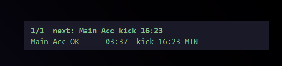

# Roblox Multi-Instance AFK Monitor

Tracks the 20-minute idle timer across multiple Roblox windows and warns you before an account gets kicked.



This tool does not send keys, mouse clicks, or messages to Roblox. It watches your own keyboard and mouse input, keeps a separate countdown for each window, checks for disconnect popups or frozen screens, and lets you switch straight to whichever account needs attention next.

## Install

Run **`Setup-RobloxAfkMonitor.exe`** (located in `dist\Setup-RobloxAfkMonitor.exe` if you build from source).

It extracts to `%LOCALAPPDATA%\Programs\RobloxAfkMonitor`, adds shortcuts to your Desktop and Start Menu, and starts in the system tray. AutoHotkey v2 is bundled inside `bin\AutoHotkey64.exe`, so you don't need to install anything else or approve an admin prompt.

On startup and every 6 hours after that, the monitor checks this repository's `manifest.json` for updates. When a new version is available, it verifies each changed file's SHA-256 hash, swaps the files in without touching your `settings.ini` or saved window slots, and reloads. You can also check manually from **Tray -> Check for updates...**

If you cloned the repository, double-click **`RobloxAfkMonitor.exe`** (or `Start Roblox AFK Monitor.bat`).

## Hotkeys

You can change any of these in `settings.ini`:

| Key | Action |
|---|---|
| `F7` | Focus the most urgent or longest-idle Roblox window. Press `F7` again within 3 seconds to cycle through the rest in urgency order. |
| `Shift+F7` | Acknowledge current alerts (stops the flashing HUD and repeat sounds for existing issues, and clears `MISSING` rows). |
| `F8` | Rename the active Roblox window (`Main`, `Alt1`, etc.). |
| `F9` | Show or hide the HUD. `F9` also opens Roblox's Developer Console, so change `ToggleHud` in `settings.ini` if you use that. |
| `Shift+F9` | Unlock the HUD to drag it anywhere on screen. Press `Shift+F9` again to lock and save its position. |

## Reading the HUD

```text
1/1  next: Main Acc kick 16:23
Main Acc OK      03:37  kick 16:23 MIN
```

- `OK`, `WARN` (15m), `URGENT` (18m): How close the window is to Roblox's 20-minute idle kick.
- `~` (as in `OK~`): You haven't pressed a key or clicked inside this window since the monitor started, so its real in-game idle time may be older than shown.
- `VD`: The window is on another Windows 10/11 Virtual Desktop (`Win+Tab`). Moving windows to another desktop won't trigger false `MISSING` or `FROZEN` alerts, and pressing `F7` switches right to that desktop when you need to check in.
- `MIN`: The window is minimized. When **Keep windows renderable** (`KeepRenderable=1`) is turned on in the tray menu, minimized clients are quietly restored behind your active window so pixel and disconnect checks can still read them.
- `DC [REASON]`: The grey disconnect box was detected on two consecutive scans. When OCR is enabled, it tags the reason (`[IDLE20]`, `[SAME_ACCT]`, `[NET]`, `[SHUTDOWN]`, `[KICKED]`, `[ERR_277]`).
- `FROZEN`: The 3D viewport hasn't changed for `FreezeSeconds` (default 45 s), which catches silent freezes where Windows still reports the process as responding.
- `HUNG`: Windows reports the window as "Not Responding" for longer than `HungGraceSeconds`.
- `MISSING`: A tracked client closed or crashed. Opening a new Roblox window reclaims that slot and keeps its label.

## Phone Notifications (ntfy.sh)

To get alerts on your phone through [ntfy.sh](https://ntfy.sh) when you're away from your desk:

1. Install the ntfy app on your phone and subscribe to a long, random topic name. Public topics don't use passwords, so make the name hard to guess.
2. Open **Tray -> Open settings.ini**, set `Topic=your-topic-name` under `[Ntfy]`, and click **Tray -> Reload settings**.
3. Click **Tray -> Send test notification** to test it. By default, notifications only go out when you haven't touched the keyboard or mouse for 2 minutes (`OnlyWhenAway=1`).

## Calibrating Disconnect Detection

If a custom shader, Bloxstrap theme, or Roblox update changes the shade of the grey disconnect popup, focus a Roblox window with the popup visible and click **Tray -> Calibrate disconnect color...** Click **Yes** to save the sampled RGB color to `settings.ini`.

## Publishing Updates

To run the test suite, update `manifest.json`, rebuild `RobloxAfkMonitor.exe` and `dist\Setup-RobloxAfkMonitor.exe`, and push a release to GitHub:

```powershell
powershell -ExecutionPolicy Bypass -File .\publish.ps1 -BumpPatch -Push -Message "Describe your change"
```
